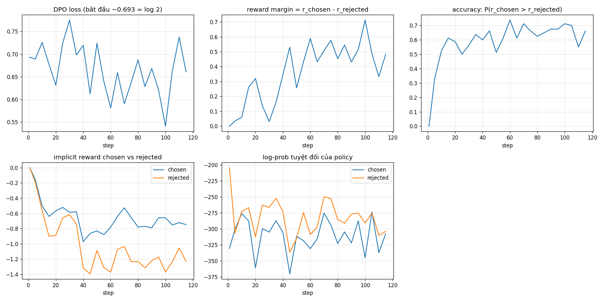

# Báo cáo Assignment 3.1 — DPO trên model nhỏ

## Kết luận đối chiếu đề bài

**Đạt yêu cầu.** Bài làm dùng một preference dataset công khai, huấn luyện DPO thật bằng TRL trên model instruction 0.5B, và có thí nghiệm tách biệt để giải thích trực tiếp hình dạng của DPO loss. Đây không chỉ là chạy `DPOTrainer`: `dpo_loss_explained.py` tự tính log-prob, implicit reward, margin và loss cho một cặp ví dụ.

| Hạng mục yêu cầu | Bằng chứng trong bài |
|---|---|
| Dataset preference | `trl-lib/ultrafeedback_binarized`, gồm cặp hội thoại `chosen`/`rejected`; lấy ngẫu nhiên 2,000 mẫu bằng seed 42. |
| Model nhỏ | `Qwen/Qwen2.5-0.5B-Instruct` (0.5B tham số). |
| Huấn luyện DPO | `trl.DPOTrainer` chạy 1 epoch trên Tesla T4, 116 optimizer steps; notebook lưu output chạy thật. |
| Phân tích loss | Ba thí nghiệm: policy = reference, overfit một cặp, và bảng loss/gradient theo margin. |

Nguồn lựa chọn: [dataset card UltraFeedback Binarized](https://huggingface.co/datasets/trl-lib/ultrafeedback_binarized/blob/main/README.md) xác nhận schema và kích thước split; [TRL Quickstart](https://huggingface.co/docs/trl/quickstart) cũng dùng chính dataset này cho ví dụ DPO. Theo [tài liệu DPOTrainer](https://huggingface.co/docs/trl/dpo_trainer), khi không truyền `ref_model`, trainer tạo một reference model cùng kiến trúc từ policy ban đầu — đúng với điều kiện khởi tạo của thí nghiệm này.

## Thiết lập thực nghiệm

| Thành phần | Giá trị |
|---|---|
| Policy và reference ban đầu | `Qwen/Qwen2.5-0.5B-Instruct` |
| Dữ liệu train | Nạp 2,000 / 62,135 preference pairs, shuffle seed 42; Trainer bỏ các mẫu bị cắt hoàn toàn |
| Loss | DPO sigmoid mặc định, `beta = 0.1` |
| Tối ưu | AdamW do Trainer tạo, learning rate `5e-6` |
| Batch hiệu dụng | `2 × 8 = 16` |
| Độ dài tối đa | 512 tokens |
| Số epoch | 1 |
| Phần cứng đã chạy | Google Colab, Tesla T4 16 GB, fp16 mixed precision |
| Thời gian đã chạy | 676 giây (khoảng 11 phút 15 giây) |

Mã chọn fp16 cho T4 (compute capability 7.5) và bf16 chỉ cho GPU có capability từ 8 trở lên. Trọng số được nạp fp32; mixed precision do Trainer đảm nhiệm. `use_cache=False` được đặt khi bật gradient checkpointing. Các thay đổi này chỉ làm cho lần chạy lại rõ ràng và ít cảnh báo hơn; chúng không thay đổi kết quả đã ghi trong notebook.

## DPO loss đang tối ưu điều gì?

Với prompt `x`, câu được chọn `y_w`, câu bị loại `y_l`, policy `πθ` và reference cố định `πref`:

```text
rθ(x, y) = β [log πθ(y | x) − log πref(y | x)]
m = rθ(x, yw) − rθ(x, yl)
L_DPO = −log σ(m)
```

Ở đây `log π(y|x)` là tổng log-prob của **các token trong response**, có điều kiện trên prompt. Vì dùng tỷ số với reference, implicit reward không phải là log-prob tuyệt đối; nó chỉ đo policy đã thay đổi bao nhiêu so với model gốc.

Đạo hàm quan trọng nhất là:

```text
dL/dm = −σ(−m)
```

Một cặp có margin âm (policy đang ưu tiên rejected) nhận gradient mạnh. Khi margin dương lớn, `σ(−m)` gần 0 nên cặp đó tự ngừng đóng góp đáng kể. Đây là nguồn gốc của đường loss giảm nhanh rồi phẳng dần.

`β` điều khiển mức policy lệch khỏi reference. Tài liệu TRL mô tả β lớn hơn là ít lệch khỏi reference hơn; vì vậy các giá trị β chỉ nên so sánh khi giữ các cấu hình khác cố định.

## Thí nghiệm kiểm soát: giải thích loss từ một cặp

File [`dpo_loss_explained.py`](dpo_loss_explained.py) tokenize prompt và response riêng rồi mới nối token IDs. Cách này tránh BPE gộp token ở ranh giới prompt/response và vô tình tính nhầm token prompt vào response loss.

Ví dụ dùng:

```text
Prompt:   Question: What is the capital of France?\nAnswer:
Chosen:   The capital of France is Paris.
Rejected: I don't know, maybe Berlin.
```

### 1. Policy trùng reference

Output đã chạy:

```text
logp(chosen)=-1.43, logp(rejected)=-35.60
reward_chosen=0.0000, reward_rejected=0.0000, margin=0.0000
loss=0.6931 = log(2)
```

Mặc dù model gốc đã gán log-prob cao hơn nhiều cho chosen, cả hai implicit reward bằng 0 vì policy và reference giống hệt nhau. Do đó `m = 0`, `σ(m)=1/2` và loss bắt đầu tại `log(2)`. Kết luận chính xác là: **một run DPO khởi tạo policy bằng reference có loss khởi đầu xấp xỉ 0.6931**; đây không phải hằng số cho mọi cách khởi tạo DPO.

### 2. Overfit duy nhất một cặp trong 30 bước

| Step | Loss | Reward chosen | Reward rejected | Margin | `σ(−m)` |
|---:|---:|---:|---:|---:|---:|
| 0 | 0.6931 | 0.000 | 0.000 | 0.000 | 0.500 |
| 3 | ~0.0000 | 0.051 | -10.513 | 10.564 | ~0.000 |
| 9 | ~0.0000 | 0.121 | -13.515 | 13.636 | ~0.000 |
| 29 | ~0.0000 | 0.001 | -15.341 | 15.343 | ~0.000 |

Loss chạm gần 0 ngay sau vài update vì margin tăng rất lớn. Margin tăng chủ yếu nhờ hạ xác suất rejected; chosen không bắt buộc phải tăng xác suất tuyệt đối. Đây là ví dụ trực quan cho việc DPO tối ưu **chênh lệch reward**, không phải một SFT loss chỉ tăng likelihood của chosen.

### 3. Hình dạng hàm

| Margin `m` | `−log σ(m)` | `|dL/dm| = σ(−m)` |
|---:|---:|---:|
| -2 | 2.1269 | 0.8808 |
| -1 | 1.3133 | 0.7311 |
| 0 | 0.6931 | 0.5000 |
| 1 | 0.3133 | 0.2689 |
| 2 | 0.1269 | 0.1192 |
| 4 | 0.0181 | 0.0180 |
| 8 | 0.0003 | 0.0003 |

Khi `m` âm lớn, loss gần tuyến tính (`L ≈ −m`) nên phạt mạnh. Khi `m` dương lớn, loss và gradient tiến về 0. Đây là lý do đường cong có dạng logistic-loss quen thuộc, không phải do một đặc tính bí ẩn của model.

## Kết quả DPO sau tiền xử lý 2,000 preference pairs

Notebook [`assignment31.ipynb`](assignment31.ipynb) ghi lại toàn bộ stdout. Các giá trị dưới đây là từ lần chạy đó, không phải đánh giá trên test set.

| Chỉ số | Bắt đầu | Cuối / tổng kết run |
|---|---:|---:|
| DPO loss | 0.6931 | train loss trung bình **0.6647** |
| Reward margin | 0.0000 | 0.3727 |
| Reward accuracy | 0.0000 | 0.5000 ở batch cuối; thường 0.55–0.73 ở nửa sau |
| Reward chosen | 0.0000 | -1.122 |
| Reward rejected | 0.0000 | -1.495 |



### Diễn giải các đường cong

- **Loss:** giảm nhẹ nhưng dao động vì mỗi log là một batch khác nhau, dữ liệu chỉ đi qua một lần, và preference pairs không đồng nhất. Một batch có vài margin âm vẫn kéo loss lên mạnh.
- **Margin và accuracy:** margin dương nghĩa là policy đã dịch theo hướng chosen tương đối với reference. Accuracy chỉ xét dấu margin, còn loss còn phạt độ tự tin chưa đủ, nên accuracy có thể tăng nhanh hơn loss giảm.
- **Chosen/rejected reward:** cả hai reward âm ở cuối run, nhưng rejected âm hơn chosen. Đây là *likelihood displacement*: policy có thể làm margin tốt hơn bằng cách giảm cả hai likelihood so với reference, miễn rejected giảm nhiều hơn. Nó nhất quán với thí nghiệm một cặp.
- **Log-prob tuyệt đối:** không nên so trực tiếp giữa chosen và rejected, vì đây là tổng theo token và chịu ảnh hưởng mạnh bởi độ dài response. Log-ratio với reference mới là đại lượng DPO dùng để loại phần lớn khác biệt sẵn có do độ dài/độ khó.

Một lưu ý kiểm chứng: `grad_norm=nan` chỉ xuất hiện ở log step đầu của run fp16. Báo cáo không dùng nó để suy luận về loss; nếu lặp lại và nó kéo dài ở các step sau thì cần hạ loss scale/learning rate hoặc kiểm tra overflow.

## Hạn chế

- Run này minh hoạ cơ chế loss, không chứng minh chất lượng sinh văn bản: chưa có win-rate, human evaluation hay eval split cố định.
- Chỉ một epoch và 2,000 mẫu nên train loss nhiễu; không nên suy rộng giá trị 0.6647 thành hiệu năng tổng quát.
- `max_length=512` có thể cắt các hội thoại dài; Trainer đã báo loại các mẫu bị cắt hoàn toàn. Đây là đánh đổi tốc độ/bộ nhớ của bài tập, cần nêu rõ nếu dùng kết quả cho nghiên cứu thực tế.

## Cách chạy lại

```python
!pip install -q -U trl transformers datasets accelerate matplotlib "pyarrow>=19,<24"
!python dpo_loss_explained.py  # kiểm chứng log(2), margin và gradient
!python dpo_train.py           # train DPO, tạo dpo_logs.json và dpo_curves.png
```
