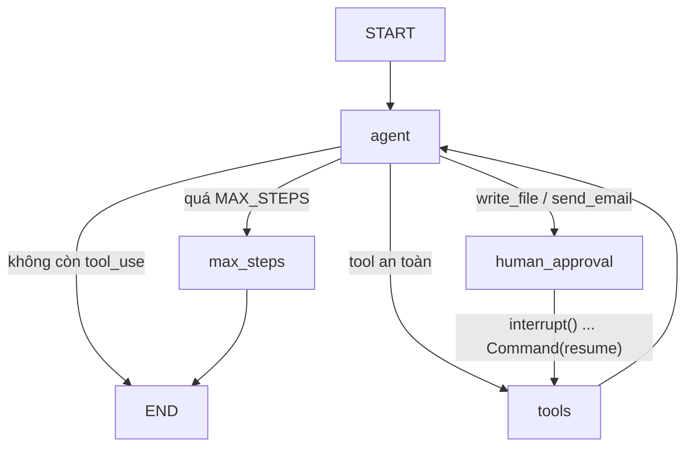

# Assignment 3.4: Agent trên LangGraph + Human-in-the-loop

## Báo cáo kiểm tra

**Kết luận:** mã đáp ứng yêu cầu bài 3.4. Agent 3.3 đã được tổ chức lại thành
`StateGraph`; các side effect `write_file` và `send_email` luôn đi qua
`human_approval` và `interrupt()` trước khi node `tools` có thể thực thi.

| Tiêu chí yêu cầu | Bằng chứng trong mã | Kết quả |
|---|---|---|
| Rebuild bằng LangGraph | `build_graph()` dùng `StateGraph(AgentState)`, có node và cạnh điều phối | Đạt |
| Interrupt trước action nguy hiểm | `route_after_agent()` chuyển sang `human_approval`; node này gọi `interrupt()` | Đạt |
| Resume và phê duyệt/từ chối | CLI dùng `Command(resume=...)`; `tools_node()` chỉ chạy action khi `approved=True` | Đạt |
| State bền vững | Graph compile với `InMemorySaver`, mọi lần chạy dùng `thread_id` | Đạt (trong một process) |
| Bảo vệ bổ sung | `write_file` giới hạn trong `workspace/`; email chỉ là mô phỏng, tạo `.eml` trong `outbox/` | Đạt |

Đã chạy ngày 06/11/2026 với `C:\phase3\.venv\Scripts\python.exe` sau khi cài
dependencies từ `requirements.txt`:

```text
python -m tests.test_graph_offline
OK test_reject
OK test_approve
OK test_rejected_email_creates_no_outbox_file
OK test_approved_path_traversal_is_still_blocked
```

Các test trên xác minh: write file không xảy ra khi bị từ chối; write file chỉ
xảy ra sau approve; email bị từ chối không tạo file outbox; và cả khi approve,
path traversal (`../../...`) vẫn bị từ chối. `python run.py --draw` cũng đã tạo
thành công `graph.mmd`.

Lưu ý: test offline dùng `FakeAgent`, nên không cần API key và không xác minh
phản hồi thực tế từ Claude. Để chạy agent thật, cần `ANTHROPIC_API_KEY` hợp lệ.

Viết lại agent của bài 3.3 bằng `StateGraph`. Thêm node `human_approval` gọi `interrupt()` trước các action nguy hiểm (`write_file`, `send_email`).
Phần giải thích "vì sao StateGraph thay vì chain" nằm trong [WHY_STATEGRAPH.md](WHY_STATEGRAPH.md).

## Cấu trúc

```
assignment 34/
├── _bootstrap.py          # thêm "assignment 33" vào sys.path để dùng lại tool của 3.3
├── lg_agent/
│   ├── tools.py           # schema 5 tool; write_file (chỉ trong workspace/), send_email (mô phỏng -> outbox/*.eml)
│   └── graph.py           # AgentState, các node, routing, build_graph()
├── run.py                 # CLI: stream từng node, hỏi duyệt khi bị interrupt
├── tests/test_graph_offline.py   # test interrupt/resume bằng FakeAgent, không cần API key
└── WHY_STATEGRAPH.md
```

## Graph



## Chạy

```bat
cd "C:\phase3\assignment 34"
pip install -r requirements.txt
copy "..\assignment 33\.env.example" .env      :: điền ANTHROPIC_API_KEY

python -m tests.test_graph_offline             :: không tốn tiền
python run.py --draw                           :: xuất graph.mmd
python run.py "Bây giờ ở Tokyo mấy giờ? Ghi câu trả lời vào file tokyo.txt"
python run.py "Tính lãi kép 10 triệu, 6.5%/năm, 5 năm rồi gửi email kết quả cho me@example.com" --auto reject
python run.py -i                               :: nhiều lượt, cùng thread_id
```

Khi bị interrupt, CLI hỏi:

```
⚠️  Agent muốn chạy: write_file({"path": "tokyo.txt", "content": "..."})
   Duyệt? [y]es / [n]o / [e]dit:
```

- `y`: chạy tool.
- `n`: nhập lý do. Model nhận `tool_result` lỗi kèm lý do và tự điều chỉnh, không retry y hệt.
- `e`: sửa tham số JSON (ví dụ đổi tên file), rồi chạy.

## Kịch bản nên thử (cho báo cáo)

1. Câu chỉ dùng tool an toàn (ví dụ T01–T10 của bài 3.3): graph **không** dừng lần nào.
2. Yêu cầu ghi file, chọn duyệt: file xuất hiện trong `workspace/`.
3. Yêu cầu gửi email, từ chối với lý do "sai người nhận": model hỏi lại hoặc đề xuất cách khác.
4. Yêu cầu ghi file `../../hack.txt`: kể cả khi được duyệt, `_safe_path` vẫn chặn (lớp bảo vệ thứ hai).
5. `-i`, hỏi tiếp câu thứ hai trên cùng thread: agent nhớ ngữ cảnh nhờ checkpointer.
