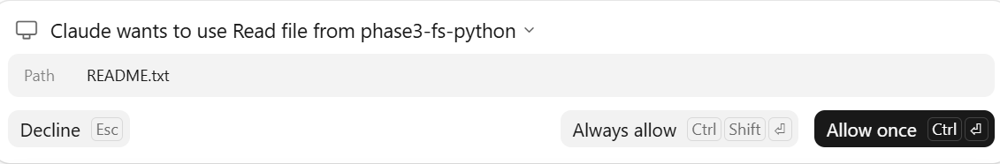

# BÁO CÁO ASSIGNMENT 3.5
## Xây dựng MCP server tối giản và phân tích wire protocol (JSON-RPC over stdio / HTTP)

| | |
|---|---|
| **Học phần** | Phase 3: LLM Agents & Tooling |
| **Bài tập** | Assignment 3.5: MCP server expose `read_file`, `list_directory`, `execute_python` |
| **Ngôn ngữ / môi trường** | Python 3.14.2 (chỉ thư viện chuẩn), Windows 11, Claude Desktop (bản Microsoft Store) |
| **Ngày thực nghiệm** | 06/11/2026 |
| **Mã nguồn** | `mcp_server.py`, `mcp_client.py`, `mcp_client_demo.py`, `mcp_agent.py`, `tests/test_server.py` |

---

## 1. Đề bài và mục tiêu

**Đề bài:** Build một MCP server đơn giản expose 3 tools: `read_file`, `list_directory`, `execute_python`. Kết nối với Claude Desktop hoặc custom agent. Mục tiêu: hiểu wire protocol của MCP (JSON-RPC over stdio/HTTP).

**Mục tiêu cụ thể mà nhóm đặt ra:**
1. Tự cài đặt protocol **không dùng SDK `mcp`**. Có như vậy mới thấy được từng byte đi trên đường truyền, thay vì để thư viện che mất.
2. Cài đặt **stdio** (Claude Desktop dùng) và một HTTP demo tối giản để quan sát cấu trúc Streamable HTTP.
3. Kết nối được với **một client thật** (Claude Desktop) và **một client tự viết** (`mcp_client.py` / `mcp_agent.py`).
4. Ghi lại toàn bộ message thật (`wire.log`) để phân tích vòng đời một phiên MCP.
5. Giới hạn phạm vi truy cập của tool (sandbox thư mục) và xử lý đúng 2 loại lỗi mà spec phân biệt.

---

## 2. Cơ sở lý thuyết

### 2.1. MCP là gì
Model Context Protocol (MCP) là giao thức chuẩn để một ứng dụng AI (**host/client**, ví dụ Claude Desktop) nối tới các **server** cung cấp tool, resource, prompt. Có thể tóm tắt:

> **MCP = JSON-RPC 2.0 + tập method quy ước (`initialize`, `tools/list`, `tools/call`, …) + một lớp transport (stdio hoặc Streamable HTTP).**

Server viết một lần là dùng được cho mọi client hỗ trợ MCP: Claude Desktop, IDE, hoặc agent tự viết.

### 2.2. Ba loại message JSON-RPC 2.0

| Loại | Có `id` | Có `method` | Bên nhận phải trả lời? |
|---|---|---|---|
| Request | có | có | **Có**, bằng response cùng `id` |
| Response | có (trùng request) | không; có `result` **hoặc** `error` | Không |
| Notification | **không** | có | **Không bao giờ** |

Response được ghép với request **theo `id`, không theo thứ tự**.

### 2.3. Vòng đời một phiên MCP
```
Client                                   Server
  │ ── initialize (protocolVersion, capabilities, clientInfo) ──▶ │
  │ ◀── result (protocolVersion chốt, capabilities, serverInfo) ─ │
  │ ── notifications/initialized  (không id, không trả lời) ───▶ │
  │ ── tools/list ──────────────────────────────────────────────▶ │
  │ ◀── { tools: [ {name, description, inputSchema}, … ] } ───── │
  │ ── tools/call {name, arguments} ────────────────────────────▶ │
  │ ◀── { content: [...], isError } ─────────────────────────── │
  │ ── (đóng stdin) ─────────────────────────────────────────────▶ │  server thoát
```
**Thoả thuận version:** nếu server hỗ trợ `protocolVersion` mà client đề nghị thì trả lại **đúng version đó**. Nếu không, server trả version mới nhất nó có, và client tự quyết định có ngắt kết nối hay không.

### 2.4. Hai transport
- **stdio:** client spawn server thành tiến trình con. Mỗi message là **một dòng** UTF-8 kết thúc bằng `\n`. Ký tự xuống dòng bên trong chuỗi JSON được escape thành `\n`, nên đó là toàn bộ cơ chế "framing". **stdout chỉ dành cho protocol**, mọi log phải ra stderr.
- **Streamable HTTP:** một endpoint `POST /mcp`; server *có thể* cấp `Mcp-Session-Id` trong response của `initialize`, notification hợp lệ nhận `202 Accepted`, còn `GET` *có thể* mở SSE stream và `DELETE` *có thể* kết thúc phiên. Bản trong bài chỉ minh hoạ các luồng POST/session/`202`, từ chối GET bằng `405`, và kiểm tra `Origin`; nó chưa phải implementation HTTP đầy đủ.

### 2.5. Hai loại lỗi
| | Khi nào | Biểu diễn | Dành cho |
|---|---|---|---|
| Lỗi **protocol** | method/tool không tồn tại, sai tham số, JSON hỏng | `"error": {"code": -32601/-32602/-32700, ...}` | code của client |
| Lỗi **tool** | tool chạy nhưng thất bại (file không có, path bị chặn, code Python lỗi) | `"result": {"content": [...], "isError": true}` | **LLM đọc và tự sửa** |

---

## 3. Thiết kế và cài đặt

### 3.1. Kiến trúc
```
┌──────────────────┐   stdio (1 dòng JSON / message)   ┌──────────────────────────────┐
│ Claude Desktop   │ ────────────────────────────────▶ │ mcp_server.py                │
│ hoặc mcp_agent / │ ◀──────────────────────────────── │  ├─ serve_stdio / serve_http │  transport
│ mcp_client_demo  │        HTTP POST /mcp (tuỳ chọn)  │  ├─ MCPServer.handle()       │  JSON-RPC dispatcher
└──────────────────┘                                   │  └─ Tools (sandbox --root)   │  nghiệp vụ
                                                       └──────────────────────────────┘
```
Code chia **3 tầng độc lập**. Nhờ vậy cùng một dispatcher `MCPServer.handle()` dùng chung được cho cả stdio lẫn HTTP, và test được trực tiếp mà không cần spawn process.

| File | Vai trò |
|---|---|
| `mcp_server.py` | Server: lớp `Tools`, dispatcher `MCPServer`, 2 transport, tham số `--root`, `--no-exec`, `--wire-log`, `--http` |
| `mcp_client.py` | Client stdio tự viết: spawn server, `request()`/`notify()`, ghép response theo `id`, xử lý `nextCursor` |
| `mcp_client_demo.py` | In từng message đi/về qua 7 kịch bản (không cần API key) |
| `mcp_agent.py` | Agent Claude: `tools/list` → `input_schema` của Claude API, `tool_use` → `tools/call` |
| `tests/test_server.py` | Test dispatcher: lifecycle, tools, các loại lỗi, và cách dispatcher xử lý batch |

### 3.2. Ba tool

| Tool | Tham số (JSON Schema) | Cài đặt |
|---|---|---|
| `read_file` | `path` (bắt buộc), `max_bytes` | Chỉ đọc file UTF-8, tối đa 200 KB. Nếu cắt giữa ký tự nhiều byte thì bỏ phần dở dang (incremental decoder) |
| `list_directory` | `path` (mặc định `.`) | Liệt kê thư mục trước, sau đó file kèm kích thước |
| `execute_python` | `code` (bắt buộc), `timeout` | Ghi code ra file tạm, chạy `python -I` trong **tiến trình riêng**, `cwd = root`, timeout ≤ 60 s, output ≤ 20 000 ký tự |

Mỗi tool có `annotations` (`readOnlyHint`, `destructiveHint`…) để client biết tool nào nguy hiểm.

### 3.3. Các quyết định quan trọng
1. **Sandbox đường dẫn:** mọi `path` đều đi qua `(root / path).resolve()` rồi kiểm tra `is_relative_to(root)`. Vì vậy `../`, đường dẫn tuyệt đối hay symlink trỏ ra ngoài đều bị chặn.
2. **Lọc biến môi trường:** `execute_python` không truyền các biến có tên chứa `KEY`, `TOKEN`, `SECRET`, `PASSWORD` cho code do LLM sinh ra.
3. **Không bao giờ trả lời notification.** Server phân biệt notification bằng điều kiện `"id" not in msg` chứ không dùng `msg.get("id")`, vì Claude Desktop dùng **`id: 0`** (xem mục 4.2). Nếu kiểm tra theo kiểu truthy thì `0` sẽ bị coi như không có id.
4. **Windows newline:** stdout được mở lại với `newline="\n"`. Nếu để mặc định, text mode sẽ đổi `\n` thành `\r\n`.
5. **Thoả thuận version:** hỗ trợ `2025-11-25`, `2025-06-18`, `2025-03-26`, `2024-11-05`.
6. **`--wire-log`:** ghi mọi dòng vào/ra kèm timestamp. Đây là công cụ chính để làm phần phân tích ở mục 4.

---

## 4. Thực nghiệm và kết quả

### 4.1. Thí nghiệm 1: client tự viết (`mcp_client_demo.py`)
Lệnh chạy: `python mcp_client_demo.py > demo_output.txt 2> demo_stderr.txt`

| # | Kịch bản | Message gửi | Kết quả thực tế |
|---|---|---|---|
| 1 | Handshake | `initialize` (2025-11-25) → `notifications/initialized` | Server chốt `2025-11-25`, trả `serverInfo` = `phase3-fs-python 1.0.0` |
| 2 | `ping` | `{"id":2,"method":"ping"}` | `{"id":2,"result":{}}` |
| 3 | `tools/list` | `{"id":3,"method":"tools/list","params":{}}` | 3 tool kèm `inputSchema` |
| 4 | `list_directory` | `{"path":"."}` | `Contents of . (1 entries): [FILE] README.txt (207 bytes)` |
| 5 | `execute_python` → `read_file` | tạo `hello.txt` rồi tính `20!` | stdout: `3.14.2 2432902008176640000`; `read_file hello.txt` → `xin chao MCP` |
| 6a | Path traversal | `read_file {"path":"../../Windows/win.ini"}` | `isError: true`, `Access denied: ... is outside the server root` |
| 6b | Code lỗi | `execute_python {"code":"1/0"}` | `isError: true`, `exit_code: 1` + traceback |
| 7a | Tool không tồn tại | `tools/call delete_everything` | `error.code = -32602 Unknown tool` |
| 7b | Thiếu tham số | `read_file {}` | `error.code = -32602 missing=['path']` |
| 7c | Method không hỗ trợ | `resources/list` | `error.code = -32601 Method not found` |
| 7d | JSON hỏng | `{this is not json` | `error.code = -32700`, **`id: null`** |

**Nhận xét:** cả 7 kịch bản đều cho đúng kết quả mong đợi. Hai loại lỗi tách bạch như thiết kế: 6a và 6b đi trong `result` với `isError`, còn 7a đến 7d đi trong `error`. Với lỗi parse (7d), server chưa đọc được `id` nên trả `id: null`, đúng quy định của JSON-RPC 2.0.

### 4.2. Thí nghiệm 2: kết nối Claude Desktop (stdio)
**Cấu hình** (`claude_desktop_config.json`, khóa `mcpServers`):
```json
"phase3-fs-python": {
  "command": "C:\\Users\\ASUS\\AppData\\Local\\Programs\\Python\\Python314\\python.exe",
  "args": ["C:\\phase3\\assignment 35\\mcp_server.py",
           "--root", "C:\\phase3\\assignment 35\\sandbox",
           "--wire-log", "C:\\phase3\\assignment 35\\wire.log"]
}
```
**Yêu cầu gửi cho Claude:** *"List the files in the sandbox, read README.txt and use Python to count its words"*

**Câu trả lời của Claude Desktop:**
> README.txt has 38 words. I counted by splitting the text on whitespace in Python.
> The sandbox is C:\phase3\assignment 35\sandbox, and it holds two files: hello.txt (12 bytes) and README.txt (207 bytes). […]

Ở lần chạy thứ hai, Claude Desktop hiện hộp thoại xin quyền trước khi gọi `read_file`:



*Hình 1. Hộp thoại xin quyền của Claude Desktop. Chữ "Read file" là trường `title`, "Path" là thuộc tính `path` trong `inputSchema`. Cả hai đều do server khai báo trong `tools/list`. Người dùng chọn Decline, Allow once hoặc Always allow.*

**Wire log thật** (`wire.log`, 20 dòng, rút gọn phần dài bằng `…`). Log gồm handshake của 2 phiên và 2 lần chạy câu hỏi:
```text
13:49:46.422 --> {"method":"initialize","params":{"protocolVersion":"2025-11-25",
                  "capabilities":{"extensions":{"io.modelcontextprotocol/ui":{"mimeTypes":["text/html;profile=mcp-app"]}}},
                  "clientInfo":{"name":"claude-ai","version":"0.1.0"}},"jsonrpc":"2.0","id":0}
13:49:46.423 <-- {"jsonrpc":"2.0","id":0,"result":{"protocolVersion":"2025-11-25","capabilities":{"tools":{"listChanged":false}},
                  "serverInfo":{"name":"phase3-fs-python","version":"1.0.0"},"instructions":"File tools are sandboxed to …"}}
13:49:46.504 --> {"jsonrpc":"2.0","method":"notifications/initialized"}
13:49:46.506 --> {"method":"tools/list","params":{},"jsonrpc":"2.0","id":1}
13:49:46.507 <-- {"jsonrpc":"2.0","id":1,"result":{"tools":[{"name":"read_file",…},{"name":"list_directory",…},{"name":"execute_python",…}]}}

13:49:46.948 --> {"method":"initialize","params":{"protocolVersion":"2025-11-25",
                  "capabilities":{"roots":{"listChanged":true},"extensions":{…}},
                  "clientInfo":{"name":"local-agent-mode-phase3-fs-python","version":"1.0.0"}},"jsonrpc":"2.0","id":0}
13:49:46.948 <-- {"jsonrpc":"2.0","id":0,"result":{…}}
13:49:46.950 --> {"jsonrpc":"2.0","method":"notifications/initialized"}
13:49:46.951 --> {"method":"tools/list","jsonrpc":"2.0","id":1}
13:49:46.951 <-- {"jsonrpc":"2.0","id":1,"result":{"tools":[…]}}

13:51:56.928 --> {"method":"tools/call","params":{"name":"list_directory","arguments":{"path":"."}},"jsonrpc":"2.0","id":2}
13:51:56.931 <-- {"jsonrpc":"2.0","id":2,"result":{"content":[{"type":"text","text":"Contents of . (2 entries):\n[FILE] hello.txt  (12 bytes)\n[FILE] README.txt  (207 bytes)"}],"isError":false}}
13:52:05.596 --> {"method":"tools/call","params":{"name":"execute_python","arguments":{"code":"import os\nprint(os.getcwd())\nt = open(\"README.txt\", encoding=\"utf-8\").read()\nprint(repr(t))\nprint(\"words:\", len(t.split()))"}},"jsonrpc":"2.0","id":3}
13:52:05.662 <-- {"jsonrpc":"2.0","id":3,"result":{"content":[{"type":"text","text":"exit_code: 0\n--- stdout ---\nC:\\phase3\\assignment 35\\sandbox\n'Day la thu muc goc …'\nwords: 38\n"}],"isError":false}}

── lần chạy thứ 2 (cùng phiên, id tiếp tục tăng) ──
13:56:50.821 --> {"method":"tools/call","params":{"name":"list_directory","arguments":{"path":"."}},"jsonrpc":"2.0","id":4}
13:56:50.822 <-- {"jsonrpc":"2.0","id":4,"result":{"content":[{"type":"text","text":"Contents of . (2 entries):\n[FILE] hello.txt  (12 bytes)\n[FILE] README.txt  (207 bytes)"}],"isError":false}}
13:57:06.496 --> {"method":"tools/call","params":{"name":"read_file","arguments":{"path":"README.txt"}},"jsonrpc":"2.0","id":5}
13:57:06.498 <-- {"jsonrpc":"2.0","id":5,"result":{"content":[{"type":"text","text":"Day la thu muc goc (root) cua MCP server.\nread_file / list_directory / execute_python chi duoc truy cap …"}],"isError":false}}
13:57:11.921 --> {"method":"tools/call","params":{"name":"execute_python","arguments":{"code":"t = open(\"README.txt\", encoding=\"utf-8\").read()\nprint(\"words:\", len(t.split()))"}},"jsonrpc":"2.0","id":6}
13:57:11.979 <-- {"jsonrpc":"2.0","id":6,"result":{"content":[{"type":"text","text":"exit_code: 0\n--- stdout ---\nwords: 38\n"}],"isError":false}}
```

**Tóm tắt các lần gọi tool từ Claude Desktop:**

| Lần chạy | `id` | Tool | Tham số | Kết quả | Thời gian xử lý |
|---|---|---|---|---|---|
| 1 | 2 | `list_directory` | `path="."` | 2 file: `hello.txt`, `README.txt` | 3 ms |
| 1 | 3 | `execute_python` | đọc README + đếm từ | `words: 38` | 66 ms |
| 2 | 4 | `list_directory` | `path="."` | 2 file | 1 ms |
| 2 | 5 | `read_file` | `path="README.txt"` | nội dung 207 byte | 2 ms |
| 2 | 6 | `execute_python` | đếm từ | `words: 38` | 58 ms |

**Cả 3 tool đều được Claude Desktop gọi thành công, không phát sinh lỗi nào.**

### 4.3. Phân tích wire log của Claude Desktop

| Quan sát | Ý nghĩa |
|---|---|
| Đúng thứ tự `initialize` → `notifications/initialized` → `tools/list` → `tools/call` | Khớp vòng đời ở mục 2.3. Server do nhóm tự viết tương thích với một client thương mại |
| `id` bắt đầu từ **0** | Đúng như dự đoán ở mục 3.3: nếu server kiểm tra notification bằng `if not msg.get("id")` thì sẽ coi `initialize` là notification và không trả lời, khiến kết nối treo |
| Claude Desktop mở **2 phiên** (2 tiến trình server) với `clientInfo` khác nhau: `claude-ai` và `local-agent-mode-phase3-fs-python` | Mỗi phiên stdio tương ứng một tiến trình con riêng. Cả hai đều có `id` bắt đầu từ 0, vì `id` chỉ cần duy nhất **trong một phiên**. Vì 2 tiến trình ghi chung một `wire.log` nên không xác định được chắc chắn lời gọi `tools/call` thuộc phiên nào |
| Client khai báo capability `roots` và `extensions.io.modelcontextprotocol/ui` | Client cho server biết những gì nó hỗ trợ. Server chỉ khai báo `tools`, nên client **không gọi** `resources/list` hay `prompts/list`. Thương lượng capability hoạt động đúng như spec |
| Phiên 2 gửi `tools/list` **không có `params`** | Server dùng `msg.get("params") or {}` nên vẫn xử lý được. Một server viết cứng `msg["params"]` sẽ lỗi ở đây |
| Lần 1 Claude dùng `execute_python` để đọc README. Lần 2 với cùng câu hỏi, Claude gọi `read_file` rồi mới dùng `execute_python` để đếm | Chọn tool nào là **quyết định của LLM**, dựa trên description, và không cố định giữa các lần chạy. Vì `execute_python` cũng đọc được file, tool mạnh có thể "nuốt" chức năng của tool hẹp hơn. Đây cũng là lý do lớp sandbox phải nằm ở server chứ không thể trông vào việc model chọn đúng tool |
| `id` ở lần chạy 2 tiếp tục từ 4, 5, 6 | Hai lần chạy dùng **chung một phiên MCP** (chung một tiến trình server). Phiên sống suốt thời gian app mở, không bị khởi tạo lại theo từng cuộc chat |
| Hộp thoại xin quyền (Hình 1) hiển thị "Read file" và "Path" | Client dùng `title` và `inputSchema` của server để dựng giao diện. Metadata trong `tools/list` vì vậy phục vụ cả LLM lẫn người dùng |
| Độ trễ: handshake ~1 ms, `list_directory`/`read_file` 1–3 ms, `execute_python` 58–66 ms | Overhead của protocol không đáng kể. `execute_python` chậm hơn chủ yếu vì phải khởi tạo tiến trình Python mới |
| Khoảng 2 phút từ `tools/list` đến `tools/call` đầu tiên | Đây là thời gian người dùng gõ câu hỏi và bấm **Allow**: Claude Desktop hỏi quyền trước mỗi lần gọi tool |

### 4.4. Thí nghiệm 3: kiểm thử đơn vị và custom agent
**Kiểm thử đơn vị** (`tests/test_server.py`) gọi trực tiếp dispatcher `MCPServer.handle()`, không spawn process và không cần mạng. Lệnh chạy: `python -m tests.test_server`.

| Test | Nội dung kiểm tra | Kết quả |
|---|---|---|
| `test_lifecycle` | `initialize` với `2025-06-18` → server trả lại đúng `2025-06-18`; với `1999-01-01` (không hỗ trợ) → fallback `2025-11-25`; `notifications/initialized` → không trả lời; `ping` → `{}` | ✅ OK |
| `test_tools` | `tools/list` trả đúng 3 tool theo thứ tự; `read_file a.txt` → `"hello"`; `list_directory` thấy `a.txt`; `execute_python print(6*7)` → `42`, `isError=false` | ✅ OK |
| `test_errors` | `read_file ../outside.txt` → `isError`; `raise SystemExit(3)` → `isError`; tool `nope` → `-32602`; thiếu `path` → `-32602`; method `foo/bar` → `-32601`; batch [request + notification] → chỉ 1 response (`id: 7`) | ✅ OK |

Output thực tế (stderr của server xen kẽ với kết quả test):
```text
[14:07:51] [mcp-server] initialize từ t None, protocol 2025-06-18 -> 2025-06-18
[14:07:51] [mcp-server] initialize từ None None, protocol 1999-01-01 -> 2025-11-25
[14:07:51] [mcp-server] client đã sẵn sàng (notifications/initialized)
OK test_lifecycle
[14:07:51] [mcp-server] tools/call read_file {"path": "a.txt"}
[14:07:51] [mcp-server] tools/call list_directory {}
[14:07:51] [mcp-server] tools/call execute_python {"code": "print(6*7)"}
OK test_tools
[14:07:51] [mcp-server] tools/call read_file {"path": "../outside.txt"}
[14:07:51] [mcp-server] tools/call execute_python {"code": "raise SystemExit(3)"}
[14:07:51] [mcp-server] tools/call nope {}
[14:07:51] [mcp-server] tools/call read_file {}
[14:07:51] [mcp-server] client đã sẵn sàng (notifications/initialized)
OK test_errors
```
**Kết quả: 3/3 nhóm test đều đạt.** Dòng `notifications/initialized` cuối cùng đến từ notification nằm trong batch: server xử lý nó nhưng không sinh response. Batch chỉ là kiểm thử khả năng chịu lỗi/khả năng tương thích của dispatcher; với MCP 2025-06-18 trở lên, client không nên gửi JSON-RPC batch.

**Custom agent và HTTP:**
- `mcp_agent.py` (custom agent dùng Claude API) và transport HTTP (`--http 8765`) đã được cài đặt nhưng **chưa chạy** trong đợt thực nghiệm này. Mục tiêu "kết nối với Claude Desktop **hoặc** custom agent" đã đạt được qua Thí nghiệm 2.

---

## 5. Khó khăn gặp phải và cách giải quyết

| # | Vấn đề | Nguyên nhân | Cách xử lý |
|---|---|---|---|
| 1 | Client crash `UnicodeEncodeError: 'charmap' codec can't encode '\u2264'` khi chạy `> demo_output.txt` | Trên Windows, khi stdout bị redirect, Python ghi bằng `cp1252`, không có ký tự `≤` và chữ tiếng Việt | Thêm `setup_console()` để ép stdout/stderr dùng UTF-8. Chỉ in mã màu ANSI khi stdout là terminal |
| 2 | Chữ tiếng Việt trong `demo_output.txt` bị lỗi font, file thành UTF-16 | Toán tử `>` của **PowerShell 5.1** giải mã output của Python theo code page console rồi ghi lại thành UTF-16. stderr bị bọc thành `NativeCommandError` | Không ảnh hưởng tới protocol (JSON dùng ASCII escape). Muốn giữ nguyên byte thì chạy qua cmd: `cmd /c "python mcp_client_demo.py > demo_output.txt"` |
| 3 | `read_file` báo nhầm "not a UTF-8 file" khi cắt đúng giữa ký tự tiếng Việt | Cắt theo byte có thể rơi vào giữa một chuỗi UTF-8 nhiều byte | Dùng incremental decoder với `final=False` khi file bị cắt |
| 4 | Không thấy file config ở `%APPDATA%\Claude` | Bản Claude Desktop cài từ Microsoft Store lưu dữ liệu ở `%LOCALAPPDATA%\Claude-Data\claude_<id>\` | Mở file bằng nút **Edit config** trong app |
| 5 | Giao diện thay đổi: không còn mục *Developer* | Phiên bản mới chuyển phần này sang **Settings → Desktop app → Extensions → Local MCP servers → Edit config** | Cập nhật README |
| 6 | Đã thêm `mcpServers` nhưng server không xuất hiện | Claude Desktop **đang chạy** và ghi đè `claude_desktop_config.json` từ bản trong bộ nhớ, khóa `mcpServers` bị mất | Thoát hẳn app (kiểm tra trong Task Manager), sửa config, rồi mới mở lại |

---

## 6. Đánh giá

### 6.1. Mức độ hoàn thành

| Yêu cầu | Trạng thái |
|---|---|
| 3 tool `read_file`, `list_directory`, `execute_python` | ✅ |
| JSON-RPC over stdio | ✅ đã kiểm chứng với Claude Desktop và client tự viết |
| JSON-RPC over HTTP | ⚠️ có HTTP demo tối giản, chưa thực nghiệm; chưa đủ điều kiện để khẳng định tương thích Streamable HTTP đầy đủ |
| Kết nối Claude Desktop | ✅ cả 3 tool được gọi thành công (`wire.log`, Hình 1, câu trả lời đúng: 38 từ) |
| Kiểm thử đơn vị | ✅ 3/3 nhóm test đạt |
| Hiểu wire protocol | ✅ phân tích ở mục 2 và 4.3, chi tiết thêm trong `PROTOCOL.md` |

### 6.2. Hạn chế
- **`execute_python` không phải sandbox bảo mật.** Nó chỉ cô lập tiến trình, đặt `cwd` và timeout. Code vẫn có quyền của user Windows hiện tại và đọc được file ngoài `--root` (ví dụ `open("C:/...")`). Lớp bảo vệ thực tế duy nhất là Claude Desktop hỏi người dùng trước mỗi lần gọi.
- Server xử lý request **tuần tự**: `notifications/cancelled` chỉ được ghi log, không huỷ được request đang chạy.
- HTTP transport không có SSE, không xác thực và chưa kiểm tra các header `Accept`, `Content-Type`, `MCP-Protocol-Version`; do đó chỉ nên dùng cho mục đích học tập cục bộ.
- Dispatcher vẫn nhận JSON-RPC batch. Batching đã bị bỏ từ MCP 2025-06-18, nên đây không phải tính năng để client MCP hiện đại sử dụng.
- Chưa cài đặt `resources`, `prompts`, `structuredContent`/`outputSchema`.

### 6.3. Hướng phát triển
1. Chạy `execute_python` trong container hoặc VM, hoặc dưới user Windows hạn chế quyền (job object giới hạn RAM/CPU).
2. Xử lý request song song bằng thread pool để hỗ trợ huỷ request và gửi `notifications/progress`.
3. Bổ sung SSE và xác thực (OAuth / bearer token) cho HTTP transport, rồi thực nghiệm với `mcp_agent.py` qua HTTP.
4. Thêm `outputSchema` để trả kết quả có cấu trúc (ví dụ `exit_code`, `stdout`, `stderr` thành các field riêng).

---

## 7. Kết luận
Nhóm đã tự cài đặt một MCP server mức học tập bằng thư viện chuẩn Python. Phần **stdio** được kết nối thành công với **Claude Desktop**: Claude tự khám phá 3 tool qua `tools/list`, rồi qua 2 lần chạy đã gọi thành công cả `list_directory`, `read_file` và `execute_python` để trả lời đúng câu hỏi (README.txt có 38 từ). Kiểm thử đơn vị đạt 3/3. `wire.log` cho thấy MCP qua stdio về bản chất là **JSON-RPC 2.0, mỗi message một dòng trên stdin/stdout**, cộng với handshake thương lượng version và capability.

HTTP trong repository là một phần mở rộng để học, chưa được thực nghiệm và chưa đầy đủ các yêu cầu của Streamable HTTP hiện hành. Vì vậy, kết luận của báo cáo chỉ dựa trên bằng chứng đã có: server đáp ứng đầy đủ yêu cầu đề bài thông qua **3 tool + JSON-RPC over stdio + kết nối Claude Desktop**, đồng thời minh hoạ được cách tổ chức transport HTTP để phát triển tiếp.

Bài học quan trọng nhất là các chi tiết "nhỏ" của protocol quyết định server có chạy được hay không: `id` có thể bằng `0`, `params` có thể vắng mặt, không được trả lời notification, stdout không được lẫn log, và phải tách lỗi tool khỏi lỗi protocol. Đó là những điều mà dùng SDK sẽ không bao giờ thấy.

---

## Phụ lục A: Hướng dẫn chạy lại
```bat
cd "C:\phase3\assignment 35"
python -m tests.test_server
cmd /c "python mcp_client_demo.py > demo_output.txt 2> demo_stderr.txt"
python mcp_server.py --http 8765          :: thử HTTP, xem PROTOCOL.md mục 4
```
Kết nối Claude Desktop: thoát hẳn app → **Settings → Desktop app → Extensions → Local MCP servers → Edit config** → thêm khóa `mcpServers` như mục 4.2 → mở lại app.

## Phụ lục B: Tài liệu kèm theo
- `PROTOCOL.md`: ghi chú chi tiết về wire protocol và thử HTTP bằng PowerShell.
- `wire.log`: log thô của phiên Claude Desktop.
- `demo_output.txt`, `demo_stderr.txt`: output của Thí nghiệm 1.
