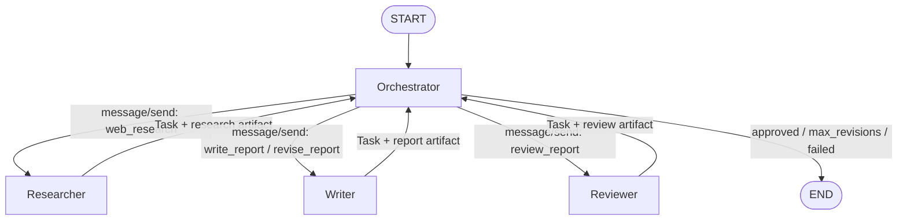

# BÁO CÁO ASSIGNMENT 3.6

## Hệ thống Multi-Agent Researcher – Writer – Reviewer với LangGraph và A2A-style Message Passing

## 1. Mục tiêu bài tập

Xây dựng hệ thống gồm ba tác tử chuyên biệt:

1. **Researcher** tìm kiếm thông tin trên web.
2. **Writer** tổng hợp ghi chú nghiên cứu thành báo cáo Markdown.
3. **Reviewer** đánh giá báo cáo và yêu cầu sửa nếu cần.

Một **Orchestrator** điều phối các tác tử theo mô hình truyền thông điệp kiểu A2A. Hệ thống được hiện thực bằng LangGraph, trong đó mỗi thành phần đảm nhiệm một node riêng.

| Hạng mục | Công nghệ / cách hiện thực |
|---|---|
| Ngôn ngữ | Python 3.10+ |
| Điều phối | LangGraph `StateGraph` |
| Mô hình ngôn ngữ | Anthropic Claude; cấu hình qua `ANTHROPIC_MODEL` |
| Tìm kiếm web | Tavily khi có API key; fallback DuckDuckGo/Wikipedia, tái sử dụng từ Assignment 3.3 theo yêu cầu bài tập |
| Trao đổi giữa agent | Agent Card, Message, Part, Task, Artifact, JSON-RPC 2.0 `message/send` |

## 2. Đối chiếu với yêu cầu đề bài

| Yêu cầu | Hiện thực | Vị trí |
|---|---|---|
| Researcher dùng web search | `ResearcherAgent` dùng tool `search_web`, tạo nhiều truy vấn và trả về findings cùng URL nguồn. | `multi_agent/agents.py` |
| Writer viết báo cáo | `WriterAgent` chỉ dùng research notes để viết hoặc sửa báo cáo Markdown, kèm trích dẫn `[n]`. | `multi_agent/agents.py` |
| Reviewer đánh giá | `ReviewerAgent` kiểm tra tính đúng đắn, độ bao phủ, cấu trúc và trích dẫn; phân loại lỗi `major`/`minor`. | `multi_agent/agents.py` |
| Orchestrator điều phối | `Orchestrator` chọn agent theo skill công bố trong Agent Card, tiếp nhận Task và quyết định bước sau. | `multi_agent/graph.py` |
| A2A-style message passing | Toàn bộ request/response được đóng gói bằng JSON-RPC với `Message`, `Task` và `Artifact`. | `multi_agent/a2a.py` |
| Node LangGraph riêng biệt | Graph có bốn node: `orchestrator`, `researcher`, `writer`, `reviewer`. | `multi_agent/graph.py` |

## 3. Kiến trúc hệ thống



Các cạnh từ Orchestrator là cạnh có điều kiện. Orchestrator ghi node kế tiếp vào trường `next`; LangGraph định tuyến theo giá trị này.

| Thành phần | Skills | Đầu vào qua Message | Artifact trả về |
|---|---|---|---|
| Researcher | `web_research` | Topic, hướng dẫn nghiên cứu | `research`: summary, findings, sources, open questions |
| Writer | `write_report`, `revise_report` | Topic, research, bản nháp/review khi sửa | `report`: Markdown |
| Reviewer | `review_report` | Topic, research, bản nháp | `review`: strengths, issues, summary, approved |
| Orchestrator | Điều phối | Task từ các agent | Quyết định bước tiếp theo và báo cáo cuối |

Các agent không gọi trực tiếp lẫn nhau và không phụ thuộc vào LangGraph. Mỗi agent có giao diện `card` và `handle(message) -> task`. Vì vậy có thể thay transport nội bộ bằng HTTP A2A trong tương lai mà không thay đổi nghiệp vụ của agent.

## 4. Thiết kế A2A-style message passing

Mô hình A2A được rút gọn để phù hợp phạm vi bài tập:

| Khái niệm | Vai trò trong hệ thống |
|---|---|
| Agent Card | Công bố tên, mô tả và skills của từng agent; Orchestrator định tuyến theo skill thay vì hard-code class. |
| Message và Part | `TextPart` mang chỉ dẫn, `DataPart` mang dữ liệu JSON như research notes hoặc review. |
| Task | Theo vòng đời `submitted → working → completed/failed`; chứa artifacts và history. |
| Artifact | Kết quả có cấu trúc của Researcher, Writer hoặc Reviewer. |
| JSON-RPC envelope | Request dùng `method: "message/send"`; response dùng cùng id và trả về `result: Task`. |

Trong phiên bản này, transport là các trường `outbox`, `inbox` và `mailbox` trong state LangGraph, chưa phải HTTP endpoint. Dù vậy, dữ liệu truyền qua các lớp này hoàn toàn là JSON và được lưu lại trong `a2a_log.jsonl`.

## 5. Chính sách điều phối và đánh giá

Orchestrator dùng chính sách tất định để dễ kiểm thử và không phát sinh token cho bước định tuyến:

1. Nếu chưa có research: gửi `web_research`.
2. Nếu chưa có bản nháp: gửi `write_report`.
3. Nếu bản nháp chưa được review: gửi `review_report`.
4. Nếu review được duyệt: kết thúc với trạng thái `approved`.
5. Nếu chưa duyệt và còn lượt: gửi `revise_report` kèm review.
6. Nếu vượt `max_revisions`: kết thúc với trạng thái `max_revisions`.
7. Nếu agent trả task lỗi: kết thúc với trạng thái `failed` và lưu lý do.

Reviewer xem research notes là nguồn chuẩn của vòng viết. Một lỗi `major` xuất hiện khi báo cáo thêm thông tin không có trong notes, trích dẫn sai, hoặc bỏ sót phát hiện trọng tâm. Lỗi `minor` áp dụng cho văn phong, cấu trúc, độ rõ ràng hoặc vấn đề vốn có trong research notes. Trạng thái duyệt do code quyết định:

```python
approved = not any(issue["severity"] == "major" for issue in issues)
```

Nhờ đó, lỗi minor vẫn được ghi nhận nhưng không cản trở việc kết thúc hệ thống.

## 6. Kết quả thực nghiệm đã lưu

Lần chạy với chủ đề `Tình hình xe điện ở Đông Nam Á năm 2025` được lưu tại `output/20261106-182520/`.

| Chỉ số | Kết quả |
|---|---|
| Findings / sources của Researcher | 15 / 14 |
| Số envelope A2A | 10 (5 request, 5 response) |
| Chuỗi skills | `web_research → write_report → review_report → revise_report → review_report` |
| Số phiên bản báo cáo | 2 |
| Trạng thái cuối | `approved` |
| Kết quả review v2 | 0 lỗi major, 3 lỗi minor |

Sản phẩm của lần chạy gồm báo cáo Markdown, transcript A2A, Agent Cards và kết quả review. Các tệp này giúp đối chiếu độc lập luồng trao đổi giữa những agent.

## 7. Kiểm thử và xác minh

Hai kiểm thử offline thay Claude bằng `FakeLLM`, nên không cần API key hay web search:

| Test | Nội dung kiểm tra |
|---|---|
| `test_revision_loop` | Luồng research → draft → review → revise → review, trạng thái `approved`, thứ tự skills và JSON-RPC id của request/response. |
| `test_max_revisions` | Hệ thống dừng an toàn ở `max_revisions` khi Reviewer luôn trả lỗi major. |

Lệnh kiểm tra:

```powershell
python -m pytest -q
python -m compileall -q .
python run.py --draw
```

Kết quả xác minh tại thời điểm bàn giao:

```text
2 passed
```

Lệnh `--draw` đã sinh lại `graph.mmd`, xác nhận graph có các node `orchestrator`, `researcher`, `writer`, `reviewer` và các cạnh hồi tiếp về Orchestrator.

## 8. Cài đặt và sử dụng

### 8.1. Yêu cầu môi trường

- Python 3.10+.
- Thư mục `../assignment 33` nằm cạnh thư mục này để tái sử dụng `search_web` và `load_dotenv` qua `_bootstrap.py`, theo yêu cầu tích hợp của bài tập.
- `ANTHROPIC_API_KEY` để chạy thật với Claude.
- `TAVILY_API_KEY` là tùy chọn; khi không có, hàm search dùng fallback đã nêu ở trên.

Ví dụ `.env`:

```text
ANTHROPIC_API_KEY=sk-ant-...
TAVILY_API_KEY=tvly-...
ANTHROPIC_MODEL=claude-haiku-5-5
```

### 8.2. Lệnh chạy

```powershell
cd "C:\phase3\assignment 36"
python -m pip install -r requirements.txt

python -m pytest -q
python run.py --draw
python run.py "Tình hình xe điện ở Đông Nam Á năm 2025"
python run.py "State of small language models in 2026" --language English --max-revisions 1
```

Mỗi lần chạy tạo `output/<timestamp>/` gồm:

| Tệp | Nội dung |
|---|---|
| `report.md` | Báo cáo cuối cùng |
| `a2a_log.jsonl` | Toàn bộ envelope request/response |
| `agent_cards.json` | Agent Card của ba agent |
| `reviews.json` | Kết quả các vòng review |

## 9. Cấu trúc mã nguồn

```text
assignment 36/
├── multi_agent/
│   ├── a2a.py       # A2A data model và JSON-RPC envelope
│   ├── agents.py    # ResearcherAgent, WriterAgent, ReviewerAgent
│   ├── graph.py     # Orchestrator và LangGraph StateGraph
│   └── llm.py       # Claude client, structured output, tool-use loop
├── tests/
│   └── test_flow_offline.py
├── _bootstrap.py    # Thêm Assignment 3.3 vào sys.path
├── run.py           # CLI và lưu output
├── graph.mmd        # Sơ đồ LangGraph sinh tự động
└── requirements.txt
```

## 10. Hạn chế và hướng phát triển

- A2A hiện là mô phỏng trong một tiến trình; bước tiếp theo là triển khai Agent Card và `message/send` qua HTTP cho từng agent.
- Chất lượng báo cáo vẫn phụ thuộc vào độ tin cậy của kết quả tìm kiếm. Có thể bổ sung bước kiểm chứng research notes trước khi Writer viết.
- Reviewer là LLM nên đánh giá có thể dao động. Có thể dùng model mạnh hơn, voting nhiều reviewer hoặc quy tắc kiểm tra trích dẫn xác định.
- Có thể bổ sung retry, timeout, checkpoint bền vững và quan sát trạng thái cho từng agent.
